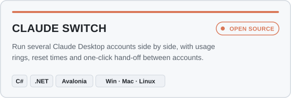
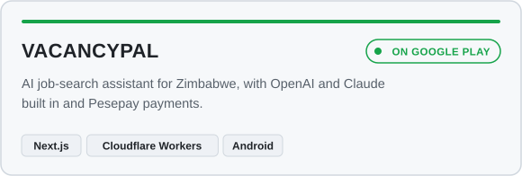
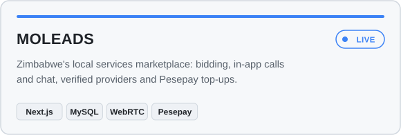
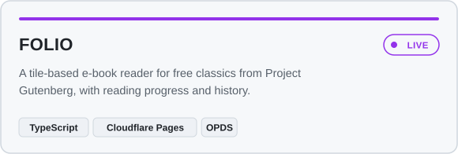
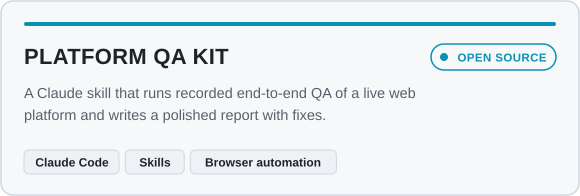
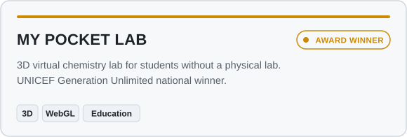

<picture>
  <source media="(prefers-color-scheme: dark)" srcset="assets/banner-dark.svg">
  
</picture>

  
  
  
  

  

## Right now

- **Lead Software Developer at Elula.** I lead backend work on a multi-tenant SaaS platform (Laravel, PostgreSQL, Auth0 SSO) and build AI agents and MCP servers on Cloudflare Workers: vector search over documents, LLM summaries, and integrations with the tools teams already use.
- **Shipping my own products** on the side, listed below, from desktop apps to Android apps on Google Play.
- **Security-minded.** I led our OWASP-driven hardening (A-grade security headers) and have spent hundreds of hours in hands-on penetration-testing labs and CTFs.

## Things I've built

<table>
  <tr>
    <td width="50%"><a href="https://github.com/Ngoni-Sama/claude-switch"><picture><source media="(prefers-color-scheme: dark)" srcset="assets/card-claude-switch-dark.svg"></picture></a></td>
    <td width="50%"><a href="https://play.google.com/store/apps/details?id=zw.co.vacancypal.app"><picture><source media="(prefers-color-scheme: dark)" srcset="assets/card-vacancypal-dark.svg"></picture></a></td>
  </tr>
  <tr>
    <td width="50%"><a href="https://moleads.co.zw"><picture><source media="(prefers-color-scheme: dark)" srcset="assets/card-moleads-dark.svg"></picture></a></td>
    <td width="50%"><a href="https://folio-c4e.pages.dev"><picture><source media="(prefers-color-scheme: dark)" srcset="assets/card-folio-dark.svg"></picture></a></td>
  </tr>
  <tr>
    <td width="50%"><a href="https://github.com/Ngoni-Sama/platform-qa-kit"><picture><source media="(prefers-color-scheme: dark)" srcset="assets/card-platform-qa-kit-dark.svg"></picture></a></td>
    <td width="50%"><a href="https://github.com/Ngoni-Sama/pocketLabs"><picture><source media="(prefers-color-scheme: dark)" srcset="assets/card-pocket-lab-dark.svg"></picture></a></td>
  </tr>
</table>

## Toolbox

   
  

| Area | What I use |
|---|---|
| **AI** | LLM apps, RAG and vector search, Model Context Protocol (MCP) servers, Claude and OpenAI APIs, Cloudflare Workers AI |
| **Backend** | Laravel, FastAPI, Node, REST APIs, Auth0 / OAuth, multi-tenant SaaS, subscription billing, Pesepay |
| **Frontend & apps** | React, Next.js, TypeScript, Tailwind, Flutter, Android (TWA), Avalonia desktop apps |
| **Cloud & data** | Cloudflare (Workers, D1, R2, Pages), PostgreSQL, MySQL/MariaDB, Firebase, Docker, CI/CD |

## Milestones

- 🏆 **National winner**, UNICEF Generation Unlimited Global Youth Challenge (2020), for My Pocket Lab
- 🥇 **1st place**, BancABC fintech hackathon (2022)
- 🎤 Presented My Pocket Lab at the **ZITF Innovators Forum** (2022)
- 🎓 **BSc Hons Computer Science**, National University of Science and Technology (NUST)

## Activity

  <picture>
    <source media="(prefers-color-scheme: dark)" srcset="https://raw.githubusercontent.com/Ngoni-Sama/Ngoni-Sama/output/snake-dark.svg">
    
  </picture>

  Like something here? A ⭐ on <a href="https://github.com/Ngoni-Sama/claude-switch">Claude Switch</a> helps a lot, and so does a <a href="https://support-ngonie.vercel.app">coffee</a>.

